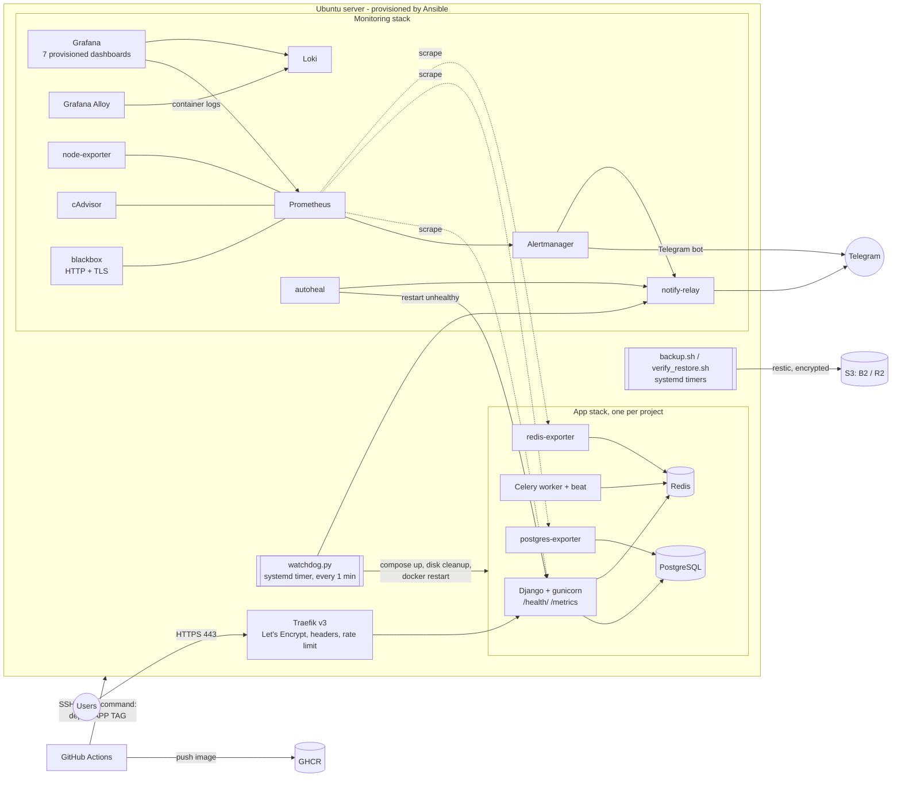
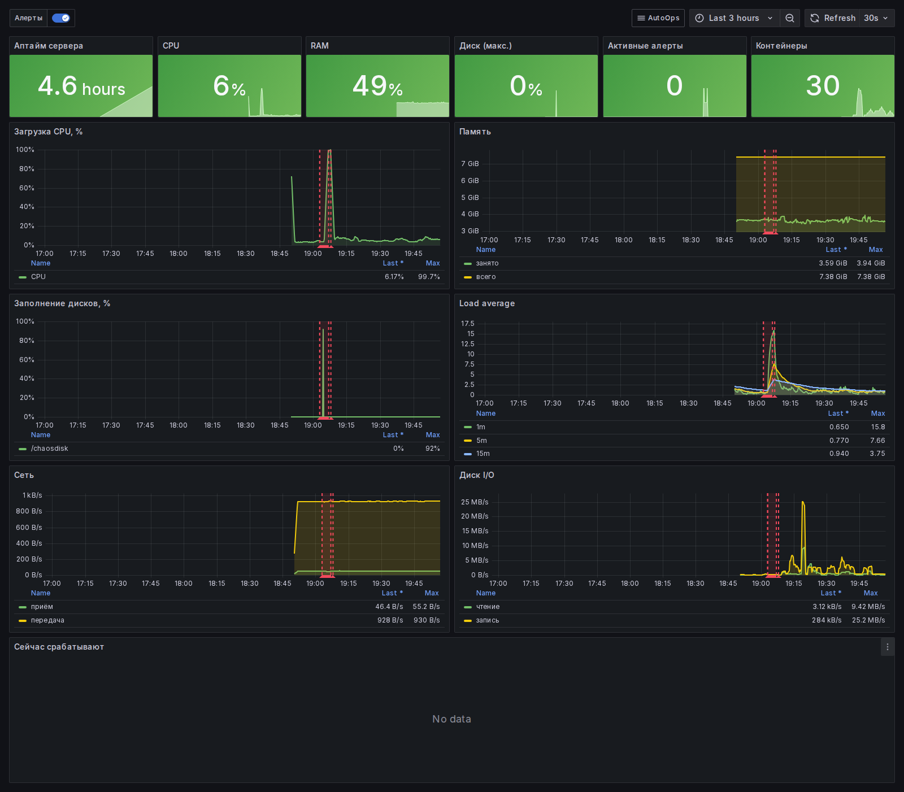
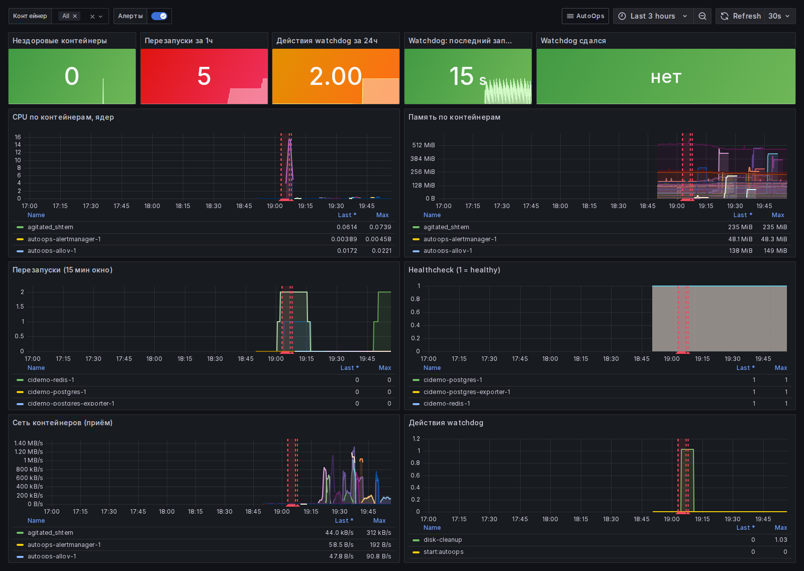
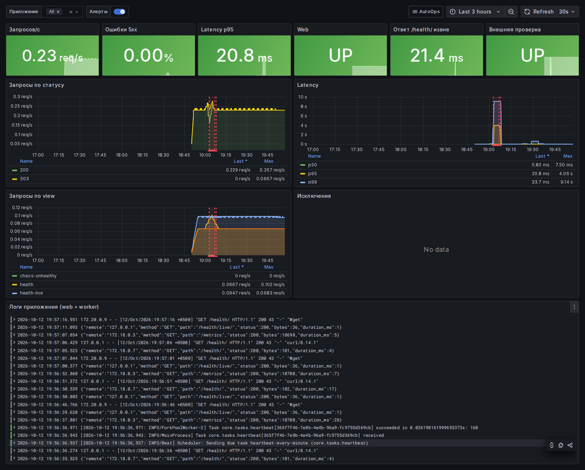
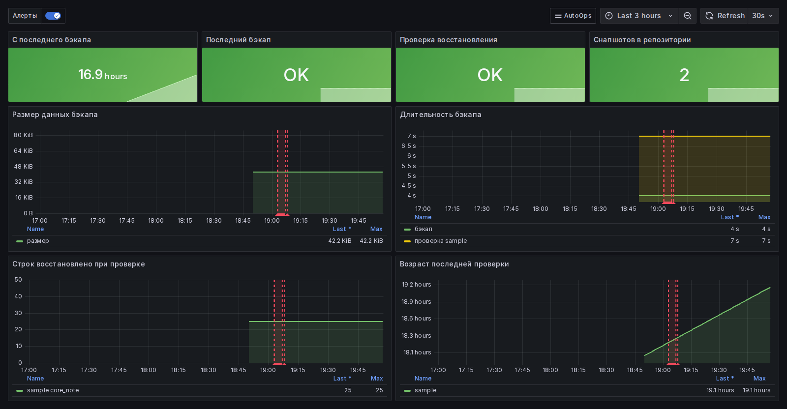
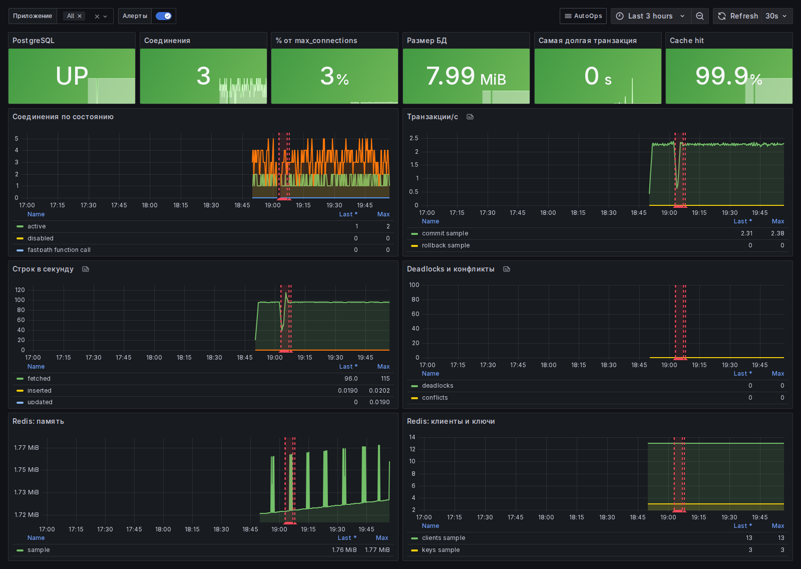
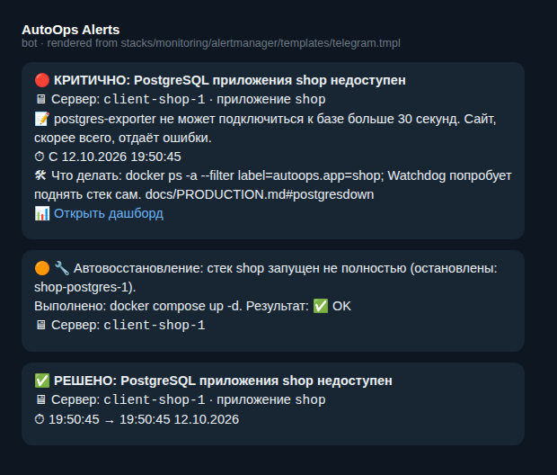

# AutoOps — self-healing infrastructure in one command

> Turn a bare Ubuntu VPS into a secure, monitored, **self-healing** platform for Django (or any Docker) apps:
> HTTPS, Grafana dashboards, Telegram alerts, encrypted off-site backups that are **restore-tested every week**,
> and CI/CD with automatic rollback. Everything is code: Ansible + Docker Compose.


## The problem
Small teams and web studios run production on "the one server nobody touches": no monitoring, backups that were
never restored, certificates that expire on a Friday night, and a deploy process that is `ssh` + prayer.
They find out about outages from their customers.

## The solution
| | Before | With AutoOps |
|---|---|---|
| Outage detection | customers complain | Telegram in < 1 min |
| Recovery | manual, 30–120 min | automatic, 1–75 s (measured, see below) |
| Backups | "somewhere", never tested | daily, encrypted, off-site, restore verified weekly |
| TLS | expires silently | auto-renewed, alert 14 days ahead |
| Deploys | manual | push → tests → image → health-gated rollout → auto-rollback |

## Architecture



## Features
1. **One-command provisioning** (`make provision`): packages, timezone, swap, sysctl, limits, security-only
   unattended upgrades, admin + restricted deploy users, SSH hardening, ufw, fail2ban, Docker CE with log rotation.
2. **App deployment** (`make deploy`): Django + Postgres + Redis + Celery behind Traefik with automatic HTTPS;
   migrations in a one-shot container; resource limits; health checks; **multiple apps per server**.
3. **CI/CD**: tests (Postgres/Redis services) → GHCR image (`sha-xxxxxxx` + `latest`) → SSH deploy → `/health/`
   check for 60 s → **automatic rollback** → Telegram message.
4. **Monitoring**: Prometheus, node-exporter, cAdvisor, postgres/redis exporters, blackbox (HTTP + certificate
   expiry); Grafana dashboards provisioned as code: Server, Containers, PostgreSQL & Redis, Application, Availability & SSL, Backups, Logs.
5. **Logs**: Loki + Grafana Alloy for every container, searchable in Grafana.
6. **Alerts in Telegram** (Russian, severity emoji, server, since when, what to do, dashboard link) — 20 rules,
   grouping, inhibition, resolved notifications, quiet hours for warnings. **9 promtool unit tests.**
7. **Self-healing**: Docker restart policies + healthchecks, `autoheal` for unhealthy containers, and a watchdog
   (systemd timer) that restarts incomplete stacks, cleans the disk, restarts a hung Docker daemon, reports every
   action and **gives up with a "human needed" alert** instead of looping forever.
8. **Backups**: daily `pg_dump` + media → restic → S3, retention 7/4/6, weekly automatic **restore into a
   throw-away Postgres with row-count checks**, metrics + alerts, interactive `make restore`.
9. **Chaos demo** (`make chaos`): kills, hangs and starves the system and measures detection/recovery/alerting.
10. **Weekly report** in Telegram: uptime, incidents, self-healing actions, backups, disks, pending security updates.

## Chaos results (laptop run, `make chaos-auto`)
| Scenario | Detected | Recovered | Alert |
|---|---|---|---|
| 1. web process killed (SIGKILL) | 4 s | 8 s | ContainerRestarted |
| 2. web hung (healthcheck failing) | 32 s | 44 s | autoheal → Telegram |
| 3. PostgreSQL stopped | 5 s | 80 s | PostgresDown + watchdog |
| 4. Disk filled to 92 % | 14 s | 17 s | watchdog "freed 276 MB" |
| 5. CPU saturated (all 16 cores) | 93 s | 228 s (load stops at 240 s) | HighCPU |

Full report: [docs/chaos-report.md](docs/chaos-report.md). Demo video script: [docs/DEMO_SCRIPT.md](docs/DEMO_SCRIPT.md).

## Screenshots
Taken from the laptop demo right after `make chaos-auto` (the CPU spike and the 92 % disk fill are visible).

| Server overview | Containers |
|---|---|
|  |  |
| **Application** | **Backups** |
|  |  |
| **PostgreSQL & Redis** | **Telegram alerts (real template)** |
|  |  |

## Quick start (laptop, Docker only)
```bash
git clone https://github.com/<you>/autoops.git && cd autoops
make local-up        # ~20 containers, all healthy
open http://localhost:3000   # Grafana: admin / autoops
make chaos           # break things and watch them heal
```
Windows: use WSL2 Ubuntu (`sudo apt install make`), see [docs/RUN.md](docs/RUN.md).

## Real server
```bash
cp ansible/inventory/hosts.example.yml ansible/inventory/hosts.yml        # IP, domain, apps
cp ansible/inventory/group_vars/all/vault.example.yml ansible/inventory/group_vars/all/vault.yml
make vault-edit                                                            # secrets, encrypted
make provision EXTRA="-e ansible_user=root" && make deploy
```

## Tech stack
Ansible (roles, vault, Molecule, ansible-lint) · Docker + Compose v2 · Traefik v3 (Caddy alternative) ·
Prometheus · Alertmanager · Grafana · Loki · Grafana Alloy · node-exporter · cAdvisor · blackbox/postgres/redis exporters ·
autoheal · restic · systemd timers · GitHub Actions · GHCR · Django 5 · Celery · PostgreSQL 16 · Redis 7 ·
shellcheck · yamllint · promtool · amtool · actionlint.

## Repository layout
```
Makefile            single entry point (make help)
ansible/            inventory, playbooks, roles: base security docker traefik app monitoring selfheal backup
stacks/             compose stacks: app, monitoring (+ configs, rules, dashboards), proxy (Traefik), proxy-caddy
scripts/            watchdog, backup/restore/verify, chaos, weekly report, dev tooling
sample-app/         Django 5 demo app with /health/, /metrics, Celery and tests
local/              laptop environment (same stacks + local S3, watchdog loop, ops cron)
tools/              image with ansible, molecule, linters, promtool, amtool, actionlint
docs/               RUN, DATA, BUSINESS, PRODUCTION, DEMO_SCRIPT, DECISIONS, PROGRESS
```

## Documentation (Russian)
[RUN](docs/RUN.md) — how to run · [DATA](docs/DATA.md) — what accounts/keys you need ·
[PRODUCTION](docs/PRODUCTION.md) — runbooks, DR, scaling · [BUSINESS](docs/BUSINESS.md) — pricing & sales ·
[DECISIONS](docs/DECISIONS.md) — architecture decisions · [PROGRESS](docs/PROGRESS.md) — what is verified.

## License
MIT
